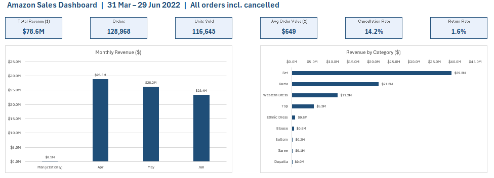

# Amazon Sales Analysis — Excel

An Excel dashboard on **128,968 Amazon India (Amazon.in) fashion orders** from 31 Mar to 29 Jun 2022. It covers revenue, orders, cancellations, returns, the monthly trend and the category mix.

---

## Dataset

Order-level sales export, one row per order line. Amounts are in **INR**.

| Field group | Columns |
|---|---|
| Order | Order ID, Date, Status, Courier Status, Qty, Amount, Currency |
| Product | Style, SKU, Category (Set, Kurta, Western Dress, Top…), Size, ASIN |
| Fulfilment | Fulfilment (Amazon / Merchant), Ship Service Level, Fulfilled By, Sales Channel |
| Customer location | Ship City, Ship State, Postal Code, Country |
| Other | Promotion IDs, B2B flag |

## What I did

1. **Data cleaning:** standardized dates and amounts, and handled blank amounts and cancelled orders (Qty = 0)
2. **Helper columns:** `Status Group` (groups detailed statuses into Shipped, Cancelled, Returned…), `Has Promo`, `Data Flag` and `Month`
3. **KPIs:** total revenue, orders, units sold, average order value, cancellation rate and return rate
4. **Dashboard:** KPI cards, a monthly revenue chart and a revenue-by-category chart

## Key findings

| KPI | Value |
|---|---|
| Total revenue | 78.6M |
| Orders | 128,968 |
| Units sold | 116,645 |
| Average order value | 649 |
| Cancellation rate | **14.2%** |
| Return rate | 1.6% |

- **Two categories make up three-quarters of revenue.** *Set* brings in 39.2M (about 50%) and *Kurta* 21.3M (27%). Western Dress is a distant third at 11.2M.
- **Revenue fell every month:** 28.8M in April, 26.2M in May and 23.4M in June, a **19% drop** from April to June. That's worth investigating (stock, pricing or seasonality).
- **About 1 in 7 orders is cancelled (14.2%)**, roughly 9× the return rate. Cutting cancellations is the bigger opportunity.

## Tools

`Excel` · `Pivot Tables` · `XLOOKUP / INDEX-MATCH` · `Conditional Formatting` · `Charts`

## Files

| File | Description |
|---|---|
| [`Amazon_Sales.xlsx`](Amazon_Sales.xlsx) | The full workbook (27 MB): `Sales_Data`, `Pivots`, `Dashboard` and `Chart_Data` sheets. Click **View raw** to download it. |
| `dashboard.png` | Dashboard screenshot |

---

**Ahmed Khaled** · Data Analyst · [LinkedIn](https://linkedin.com/in/ahmed-khaled-347711287) · [GitHub](https://github.com/ahmed-dataanalystt)
